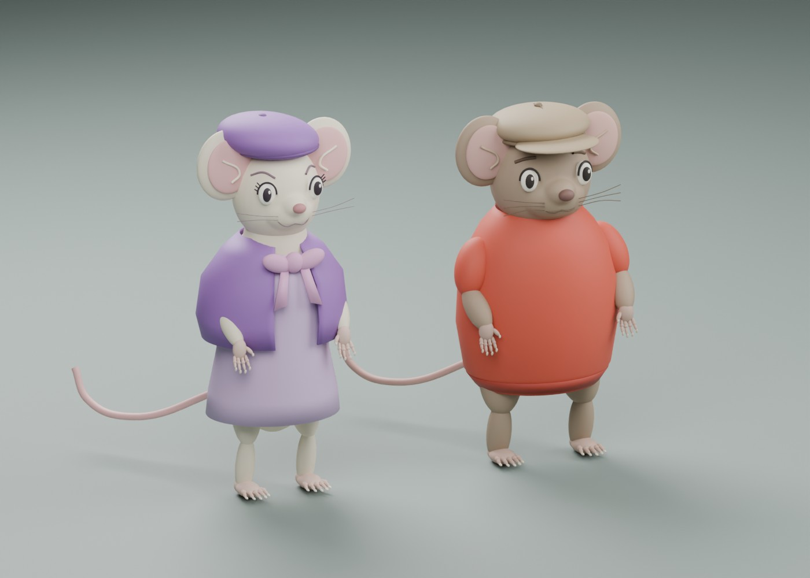

# Bianca e Bernie — modelli 3D di studio

Aggiornamento del **19 ottobre 2026**. Bernie è il guidatore; Bianca è la vedetta. L’utente ha richiesto anche l’adattamento delle corporature agli studi di animazione, con Bianca più affusolata, consentendo la locomozione bipede. Gli occhi sono ridotti di circa un terzo rispetto al primo modello, meno sporgenti e più vicini al volto; pupille, palpebre, ciglia e sopracciglia sono adattate in proporzione. Le mani e i piedi hanno ora dita distinte, articolazioni, talloni e piccole unghie al posto delle precedenti forme ovali.

## File disponibili

| File | Uso |
| --- | --- |
| `godot/assets/characters/bernie.glb` | Bernie, maglione rosso e coppola, corporatura compatta |
| `godot/assets/characters/bianca.glb` | Bianca, abito da picnic, mantellina e berretto viola, fiocco, corporatura slanciata |
| `godot/scenes/characters.tscn` | Confronto indipendente dal laboratorio di guida |
| `art/source/characters.blend` | Scena Blender modificabile con materiali, costumi e luci |
| `tools/blender/build_characters.py` | Sorgente completo e riproducibile delle mesh, abiti, materiali e studio di luci |
| `data/config/characters.json` | Proporzioni e palette di lavoro |
| `art/previews/characters/` | Render reali: fronte, lato, retro, tre quarti e dettagli di zampe e musetti |

Una copia modificabile è salvata in `art/source/characters.blend`. Il generatore scrive una nuova copia in `art/source/generated/characters/characters.blend`; quella cartella resta esclusa dal controllo versione. Il pacchetto consegnato in chat contiene anche il file Blender. Il generatore di ingombri dell’auto usa la stessa costruzione dei personaggi, evitando due design divergenti.

## Adattamento degli studi

Bernie: massa del busto più raccolta, testa più piena e musetto corto con superficie continua, sopracciglia prudenti, coppola con visiera e cucitura, maglione con bordi a coste. Bianca: tronco più stretto e lungo, testa più delicata, musetto accorciato e nasino piccolo, palpebre e ciglia, berretto inclinato, mantellina aperta e fiocco. I costumi sono superfici separate dal corpo. Le dimensioni sono provvisorie; i colori sono interpretazioni artistiche, non campioni esatti dei cel.

Fonti: [catalogo](../references/bianca_bernie/README.md) e [studi pubblicati da Andreas Deja](https://andreasdeja.blogspot.com/2013/05/bernard-bianca.html), visualizzati durante la modellazione. Nessuna immagine esterna è incorporata come texture.

## Verifiche e limiti

Generazione, esportazione GLB e sei viste eseguite in **Blender 4.5.9 LTS**. Ispezione visiva dei render per silhouette, costumi e zampe. Il controllo `godot/tests/character_checks.gd` verifica il caricamento reale, la corporatura più stretta di Bianca, la presenza delle dita e l’assenza di corpi fisici aggiuntivi. Importazione e controllo passati in Godot 4.5.1, insieme all’avvio headless del laboratorio per tre frame; questo è un controllo di caricamento, non un collaudo dinamico.

Sono modelli di studio statici, con parti e pivot della testa modificabili. Skinning, espressioni animate, cammino bipede, posa seduta, presa su volante/pedali e scalata della coffa restano da realizzare. La nuova silhouette non equivale a una locomozione già animata. Le fasi P1/P3/P4 restano aperte per questi collaudi.
