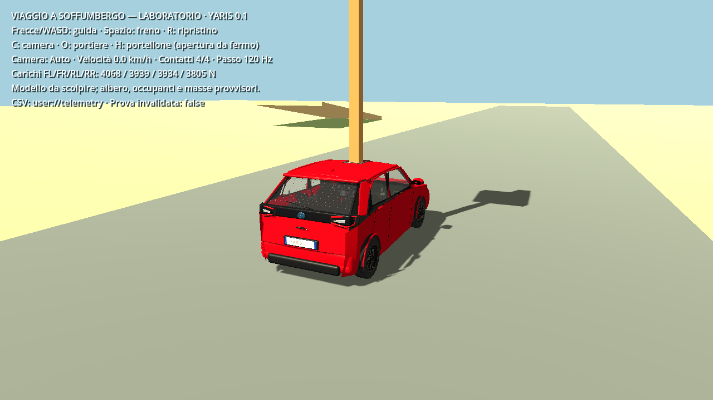
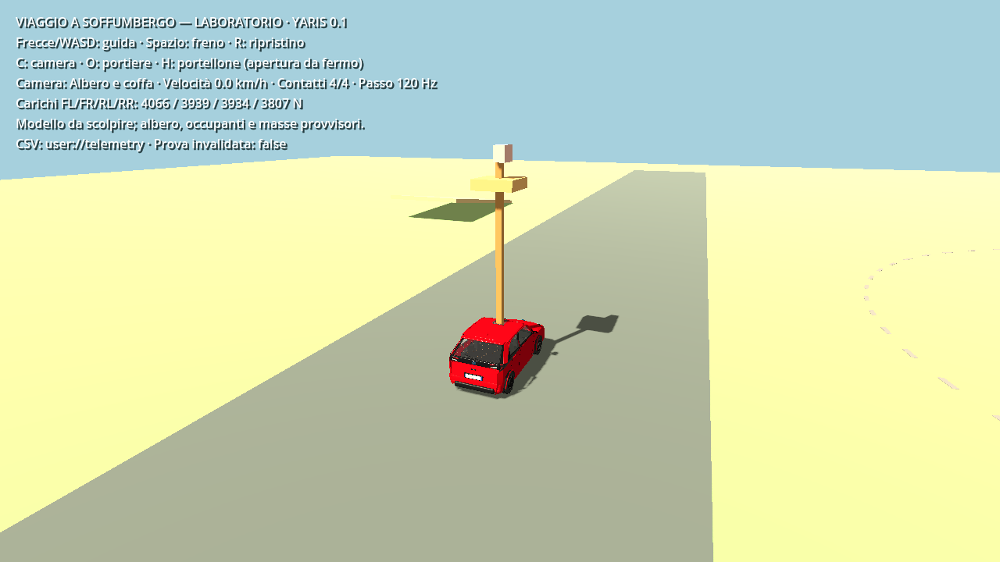
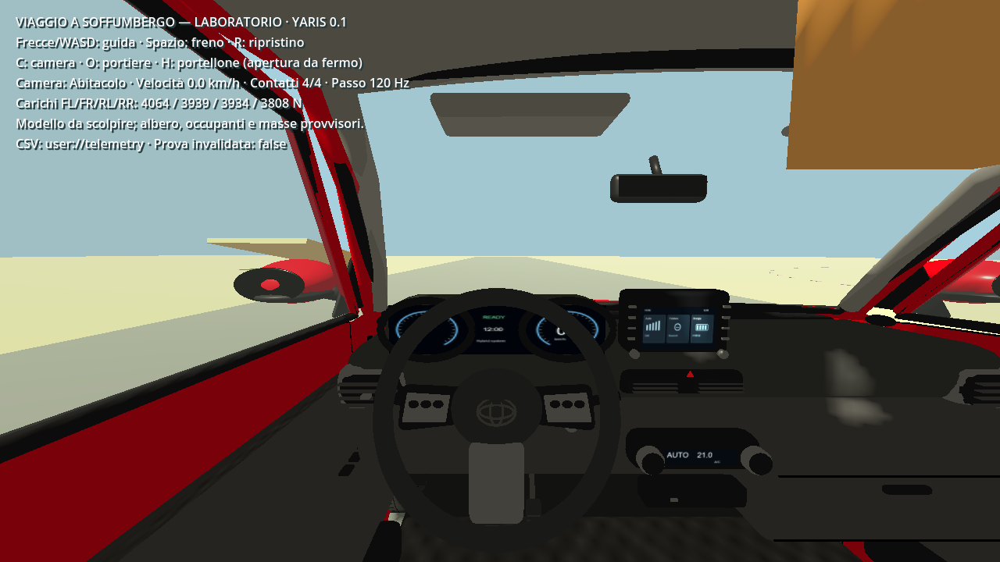
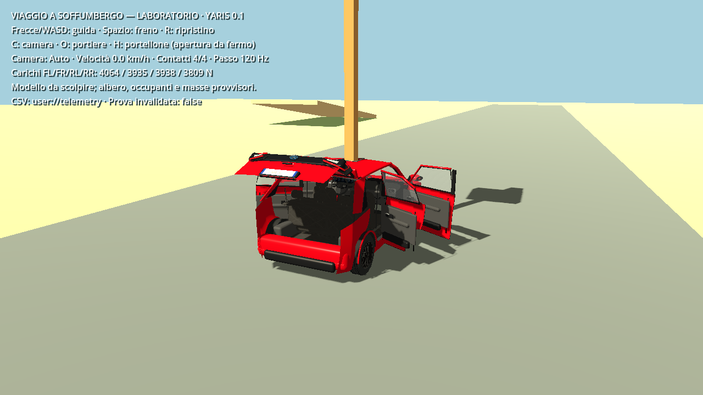

# Yaris 0.1 nel laboratorio — 19 ottobre 2026

Il progetto avvia `godot/scenes/lab.tscn`, con la variante Yaris dotata di foro reale nel tetto. Il modello segue il corpo fisico già presente: nessuna seconda massa, quattro ruote sulle sospensioni e sterzo anteriore sincronizzati. La geometria resta quella della versione 0.1, ancora da scolpire sostanzialmente.

## Avvio e comandi

Aprire `project.godot` in Godot 4.5.1, attendere l'importazione e premere F5.

| Tasto | Azione |
| --- | --- |
| Frecce / WASD | Accelerazione, retromarcia e sterzo |
| Spazio | Frenata |
| C | Auto → albero e coffa → abitacolo |
| O | Quattro portiere |
| H | Portellone |
| R | Ripristino al punto di partenza e invalidazione della prova |

L'apertura dei pannelli richiede velocità inferiore a 0,2 m/s; la chiusura resta disponibile. Albero, coffa, occupanti, collisioni e masse sono provvisori. Il piazzale sintetico non rappresenta il percorso reale.

## Prova eseguita

Windows x64, Godot 4.5.1 stable/Jolt, GL Compatibility, Radeon RX 6800, OpenGL 3.3, driver 26.8.1.260806. Fisica a 120 Hz, avanzamento del test a 60 frame/s: quest'ultimo valore è imposto, non un benchmark.

`godot/tests/lab_yaris_check.gd` carica la vera scena principale e invia gli input al suo gestore. **28 controlli superati, zero errori**. Verifica quattro contatti, un solo corpo rigido da 1.605 kg, mesh reali, tre camere, porte/portellone, blocco apertura in movimento, accelerazione, verso del rotolamento, sterzo anteriore, escursione visiva delle sospensioni, curva a destra tramite forze, frenata e ripristino.

Risultati grezzi in [lab_integration.json](lab_integration.json): dopo la prima fase di accelerazione 1,343 m percorsi e 2,524 m/s; durante la curva velocità angolare −0,494 rad/s; frenata da 3,663 a 0,0663 m/s. Sono risposte del modello sperimentale, non misure o prestazioni Toyota. La soglia di questa prova di frenata è 0,2 m/s; non sostituisce il banco statico con soglia 0,02 m/s.

Per riprodurre con l'eseguibile Godot installato:

```text
godot --path . --rendering-method gl_compatibility --resolution 1280x720 --fixed-fps 60 --script godot/tests/lab_yaris_check.gd -- --capture-dir=reports/yaris_2022
```

Senza `--capture-dir` è disponibile anche la variante headless, con 20 controlli anziché 28 (gli otto aggiuntivi verificano acquisizione e salvataggio delle immagini). Nel contesto ristretto il processo nativo ha richiesto accesso al desktop/driver; l'esecuzione sul desktop ha completato la prova con codice di uscita 0.

## Immagini acquisite nel gioco









Queste immagini verificano la presenza del modello nel laboratorio. Fedeltà delle forme, illuminazione finale, personaggi, prove dinamiche prolungate e prestazioni del percorso completo restano da completare. Il limite del banco statico a 60 Hz rimane registrato in [VERIFICA.md](VERIFICA.md).
